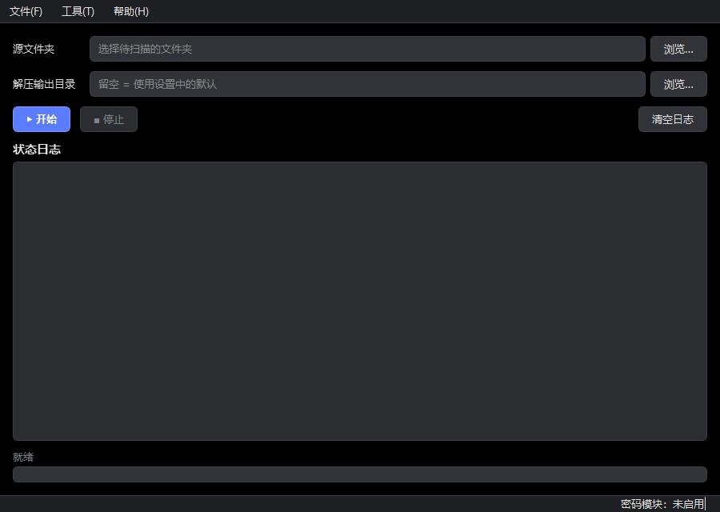
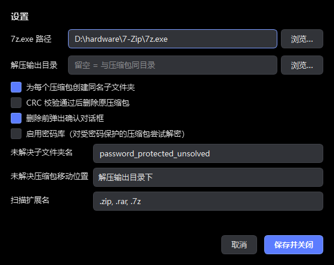
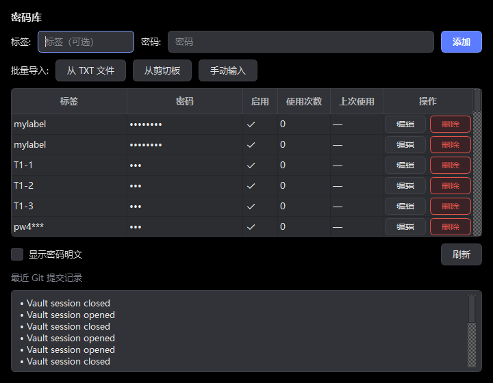

# 密码识别并自动解压缩 · Archive Auto-Extractor

> **本仓库已并入 folder-ops，后续维护请前往 https://github.com/SuHu4088/folder-ops**


[](https://www.python.org/)
[](https://www.riverbankcomputing.com/software/pyqt/)
[](https://7-zip.org/)
[](LICENSE)
[](tests/)

> 一键递归扫描文件夹，自动解压 ZIP / RAR / 7Z 压缩包，CRC 完整性校验，密码库自动尝试解密，深色模式 GUI。



## 目录

- [项目概述](#项目概述)
- [功能特性](#功能特性)
- [截图预览](#截图预览)
- [环境要求](#环境要求)
- [安装指南](#安装指南)
- [使用方法](#使用方法)
- [配置项说明](#配置项说明)
- [开发文档](#开发文档)
- [常见问题](#常见问题)
- [贡献说明](#贡献说明)
- [许可证](#许可证)

## 项目概述

「密码识别并自动解压缩」是一个 Windows 桌面应用，用于批量处理文件夹中的压缩包。选择一个文件夹后，程序会递归扫描其中的 ZIP / RAR / 7Z 压缩包，自动解压到同名子文件夹，并对解压结果做 CRC 完整性校验。

对于受密码保护的压缩包，程序默认跳过；启用密码库后，会从密码库逐一尝试解密。密码库独立存放于项目外部，每次增删改查都会自动 Git 提交，变更可追溯、可回滚。

整体采用**分层架构**，核心逻辑不依赖 GUI 框架，便于单元测试与复用。所有 7z 调用经过统一封装，避免挂起等待输入。

## 功能特性

- 📁 **递归扫描**：选择文件夹后自动遍历所有子目录，识别 ZIP / RAR / 7Z 压缩包
- 🔓 **密码识别**：自动检测受密码保护的压缩包，默认跳过，避免无谓尝试
- 🔑 **密码库**：启用后从密码库逐一尝试解密；全部失败时将压缩包移入 `password_protected_unsolved/` 并提示「已尝试所有密码仍无法打开」
- ✅ **CRC 校验**：解压后比对存储 CRC 与解压文件 CRC（`7z l -slt` + `zlib.crc32` + `7z t` 三重校验），确保完整性
- 🗑️ **安全删除**：仅在 CRC 校验通过后才允许删除原压缩包，提供确认对话框 + 设置开关
- 📂 **同名子文件夹**：解压内容放入与原压缩包同名的子文件夹，避免文件混淆
- 🎨 **深色主题**：高对比度深色界面，状态/进度实时可见
- 📜 **状态实时提醒**：当前文件路径、操作阶段（扫描/解压/校验）、进度、成功/失败全程可见
- 🔐 **密码库 Git 追踪**：密码库存放于项目外，每次增删改查自动 Git 提交，变更可追溯可回滚
- 📥 **密码批量导入**：支持从 TXT 文件、剪切板、手动输入批量导入密码，自动去重

## 截图预览

### 主界面

深色主题主界面，包含源文件夹选择、输出目录、开始/停止控制、状态日志和进度条。


### 设置对话框

可配置 7z 路径、输出目录、同名子文件夹、删除行为、密码模块开关等。



### 密码库管理

密码库表格 CRUD，密码默认掩码显示，底部显示 Git 提交记录。



## 环境要求

- **操作系统**：Windows 10/11（在其他平台需调整 7z 路径）
- **Python**：3.10+（开发使用 3.12.8）
- **7-Zip**：命令行工具 `7z.exe`。默认路径 `C:\Program Files\7-Zip\7z.exe`，可在设置中修改
- **Git**：用于项目版本管理与密码库变更追踪

## 安装指南

### 方式一：从源码运行

```bash
# 1. 克隆仓库
git clone https://github.com/<your-username>/archive-auto-extractor.git
cd archive-auto-extractor

# 2. 创建虚拟环境（推荐）
python -m venv .venv
.venv\Scripts\activate

# 3. 安装依赖
pip install -r requirements.txt
```

### 方式二：使用免安装 EXE

前往 [Releases](../../releases) 页面下载最新的 `ArchiveAutoExtractor.zip`，解压后双击 `ArchiveAutoExtractor.exe` 即可直接运行，无需安装 Python 环境或任何依赖。

> EXE 已内置 Python 运行时与所有依赖，仅需确保系统已安装 [7-Zip](https://7-zip.org/)。

## 使用方法

### 启动程序

```bash
python run.py
```

### 操作流程

1. **选择源文件夹**：点击「选择文件夹」按钮，选定待处理的文件夹
2. **配置解压路径**：在「设置」中指定解压输出目录（默认与源文件夹相同）
3. **（可选）启用密码库**：在「设置」中开启密码模块，并通过「密码库」对话框添加密码
4. **开始处理**：点击「▶ 开始」按钮，程序递归扫描并自动处理压缩包
5. **观察状态**：底部状态面板与进度条实时显示处理过程
6. **删除确认**：若开启「成功后删除原文件」，CRC 校验通过后会弹出确认对话框

### 处理逻辑

| 压缩包状态 | 处理方式 |
|---|---|
| 未加密 | 直接解压 → CRC 校验 → （可选）删除原文件 |
| 加密 + 密码模块关闭 | 跳过（原位不动） |
| 加密 + 密码模块开启 | 逐个尝试密码 → 命中则解压+校验 → 全失败移入 unsolved 文件夹 |

## 配置项说明

配置文件为 `config.json`，用户运行时选择会保存到 `config.local.json`（已被 Git 忽略）。

| 配置项 | 默认值 | 说明 |
|---|---|---|
| `seven_zip_path` | `C:\Program Files\7-Zip\7z.exe` | 7z.exe 路径 |
| `extraction_output_root` | `""`（空=源文件夹） | 解压输出根目录 |
| `create_same_name_subfolder` | `true` | 为每个压缩包创建同名子文件夹 |
| `delete_original_after_success` | `false` | CRC 校验通过后是否删除原文件 |
| `confirm_before_delete` | `true` | 删除前是否弹出确认对话框 |
| `password_module_enabled` | `false` | 是否启用密码库尝试解密 |
| `move_unsolved_to_subfolder` | `true` | 全部密码失败后移入 unsolved 子文件夹 |
| `unsolved_subfolder_name` | `password_protected_unsolved` | 未解决压缩包子文件夹名 |

## 开发文档

完整开发文档位于 [`docs/`](docs/) 目录：

| 文档 | 说明 |
|---|---|
| [架构设计](docs/architecture.md) | 分层架构、线程模型、数据流、配置持久化 |
| [模块说明](docs/modules.md) | 各模块职责与关键 API |
| [核心算法](docs/algorithms.md) | 密码检测、CRC 校验、密码尝试策略 |
| [API 文档](docs/api.md) | 核心层公开接口参考 |
| [开发规范](docs/development.md) | 代码风格、测试规范、提交规范 |
| [常见问题](docs/faq.md) | 安装、使用、密码库、兼容性、安全 |

## 常见问题

详见 [docs/faq.md](docs/faq.md)。以下为高频问题：

<details>
<summary><b>启动时报「7z.exe not found」</b></summary>

7-Zip 未安装或路径不符。打开「工具 → 设置」，在「7z.exe 路径」选择正确的 `7z.exe`。默认路径为 `C:\Program Files\7-Zip\7z.exe`，可从 [7-zip.org](https://7-zip.org) 下载安装。
</details>

<details>
<summary><b>为什么受密码保护的压缩包被跳过了？</b></summary>

这是设计行为。默认密码模块关闭，避免无谓尝试。在「工具 → 设置」勾选「启用密码库」，然后通过「工具 → 密码库」添加密码，即可自动尝试解密。
</details>

<details>
<summary><b>原始压缩包会被删除吗？</b></summary>

**默认不会**。只有同时满足以下条件才删除：
1. 在设置中开启「CRC 校验通过后删除原压缩包」。
2. 解压成功且 CRC 校验通过。
3. 弹出确认对话框时点击「是」（除非关闭了确认）。

删除优先送入回收站（需 `send2trash` 包），可从回收站恢复。
</details>

## 贡献说明

欢迎提交 Issue 与 Pull Request。请遵循以下流程：

1. **Fork** 本仓库并克隆到本地
2. 创建功能分支：`git checkout -b feature/your-feature`
3. 安装依赖并运行测试：`pip install -r requirements.txt && pytest`
4. 编写代码，确保通过全部测试：`pytest -q`
5. 提交更改，遵循 [约定式提交](https://www.conventionalcommits.org/) 规范
6. 推送分支并提交 Pull Request

### 提交信息规范

```
<type>: <subject>

<body>
```

常用 type：`feat`（新功能）、`fix`（修复）、`docs`（文档）、`refactor`（重构）、`test`（测试）、`chore`（构建/工具）。

### 代码规范

- Python 代码遵循 [PEP 8](https://peps.python.org/pep-0008/) 风格
- 核心层（`src/archive_extractor/core/`）除 `worker.py` 外不依赖 PyQt6，保证可单元测试
- 新功能需附带测试用例（位于 `tests/`）
- 详细规范见 [开发规范文档](docs/development.md)

## 许可证

本项目基于 [MIT License](LICENSE) 开源，可自由使用、修改和分发。

---

<p align="center">使用 PyQt6 + 7-Zip 构建 · 深色模式桌面应用</p>
